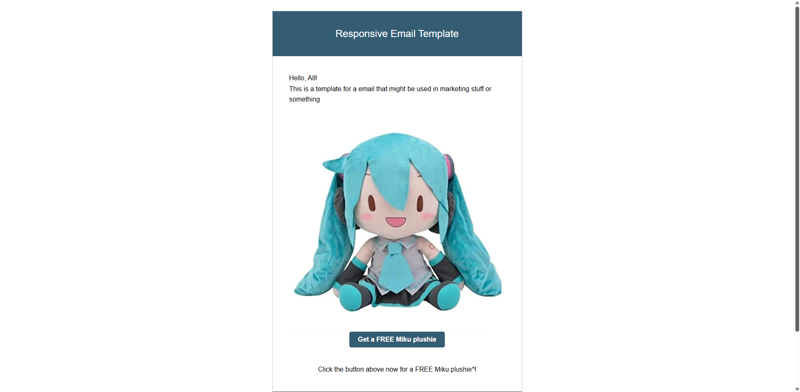
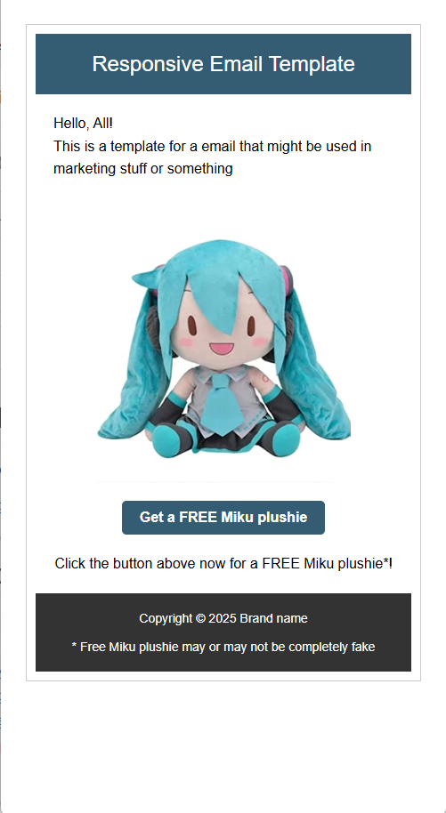

# HTML Email Template

A simple template with placeholder image and text for a HTML email. Made for the ITOnlinelearning course.

Live Demo: https://html-email-template-steel.vercel.app/

---

## Table of Contents

- [Overview](#overview)
- [Features](#features)
- [Tech Stack](#tech-stack)
- [Screenshots](#screenshots)
- [Deployment](#deployment)
- [Future Improvements](#future-improvements)
- [Credits](#credits)

---

## Overview
As part of the ITOnlineLearning HTML and Web essentials programme, I was tasked with completing several coding projects. One of them was to create a simple, responsive email template using HTML and CSS so I created this simple template to fulfil this task.

The template contains a title, some text, an image accompanied by a button. There is text underneath the button acting as a call to action. There is also some sample copyright information in the footer. All of this is encompassed within a simple box with some colour.

### Motivation
I was inspired by various examples of emails that companies use to market products or services.

### Objective
The objective was to create a template for a responsive marketing email using HTML and CSS.

### Learning Outcomes
- Use CSS to create an email template with a responsive layout

---

## Features
- Responsive layout - the elements adjust their size according to the screen width

---

## Tech Stack

### Frontend
- HTML
- CSS

---

## Screenshots

---

## Deployment

- Frontend deployed on Vercel

---

## Credits

Developer: Ifath Chowdhury
GitHub: https://github.com/Ifath-Chowdhury
